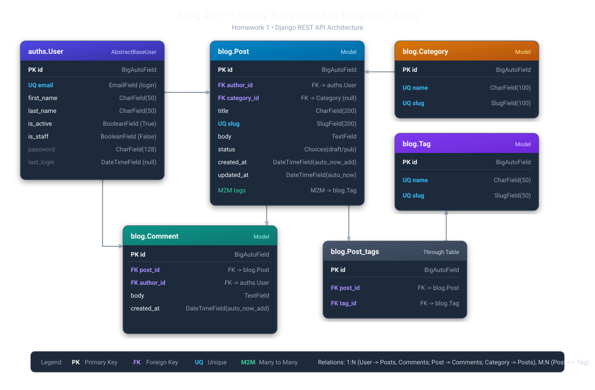

# Blog API

RESTful API backend for a modern blogging platform built with Django and Django REST Framework.

## Entity Relationship Diagram (ERD)



### Data Models Summary

- **auths.User**: Custom user model extending `AbstractBaseUser` and `PermissionsMixin` with email as the unique primary login field (`USERNAME_FIELD = 'email'`), required first and last names, and custom manager for normalization and password hashing.
- **blog.Category**: Post categorization with unique name and slug.
- **blog.Tag**: Tagging taxonomy with unique name and slug.
- **blog.Post**: Articles authored by users, associated with categories and tags, featuring draft/published lifecycle status and automated timestamps.
- **blog.Comment**: User comments on blog posts with cascade deletion and creation timestamps.

## Project Structure

```text
blog_api/
├── apps/
│   ├── auths/             # Custom user model, managers
│   └── blog/              # Categories, tags, posts, comments
├── docs/
│   └── erd.svg            # Architecture entity relationship diagram
├── logs/                  # Application runtime log files
├── requirements/
│   ├── base.txt           # Core project dependencies
│   ├── dev.txt            # Development tooling (ruff, faker)
│   └── prod.txt           # Production packages (psycopg2-binary)
├── settings/
│   ├── env/
│   │   ├── local.py       # Development environment configuration (SQLite)
│   │   └── prod.py        # Production environment configuration (PostgreSQL)
│   ├── .env.example       # Template for environment variables
│   ├── asgi.py            # ASGI application entrypoint
│   ├── base.py            # Shared settings across environments
│   ├── conf.py            # Decouple configuration parser
│   ├── urls.py            # Root URL routing
│   └── wsgi.py            # WSGI application entrypoint
├── manage.py              # CLI management script with dynamic env selection
├── pyproject.toml         # Ruff linter and code quality configuration
└── README.md
```

## Settings Load Order

Configuration follows a deterministic hierarchy:

`manage.py` → `settings/env/local.py` → `settings/base.py` → `settings/conf.py` → `settings/.env`

- `manage.py` reads `BLOG_ENV_ID` from `settings/.env` to determine `DJANGO_SETTINGS_MODULE` (`settings.env.local` or `settings.env.prod`).
- All environment variables use the `BLOG_` prefix to prevent collision.

## Quick Start

### 1. Environment Setup

Create and activate a virtual environment, then install dependencies:

```bash
pip install -r requirements/dev.txt
```

### 2. Configure Environment Variables

Create `settings/.env` based on `settings/.env.example`:

```env
BLOG_ENV_ID=local
BLOG_SECRET_KEY=your-secret-key-change-in-production
BLOG_DEBUG=True
BLOG_ALLOWED_HOSTS=localhost,127.0.0.1
```

### 3. Run Migrations

```bash
python manage.py migrate
```

### 4. Create Superuser

```bash
python manage.py createsuperuser
```

### 5. Run Development Server

```bash
python manage.py runserver
```

## Quality and Testing

Execute the test suite:

```bash
python manage.py test
```

Run code style and PEP 8 linter:

```bash
ruff check .
```
